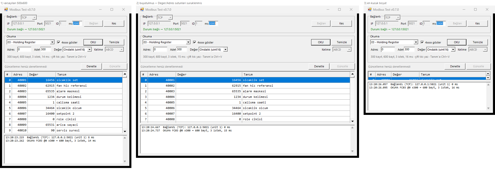
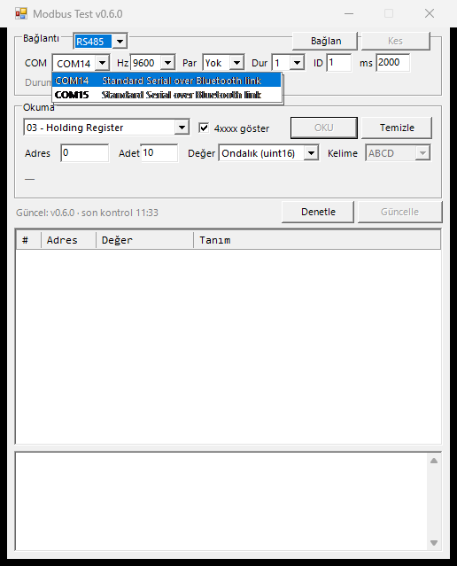
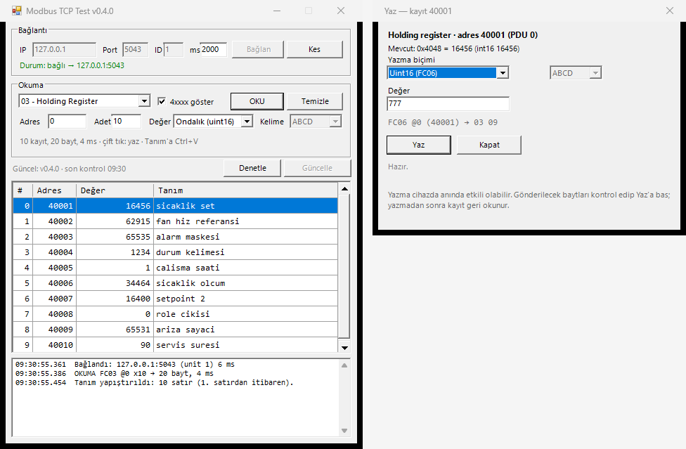

# ModbusScan

Kompakt (varsayılan **500 × 600 px**, istediğin boyuta getirilebilen) bir **Modbus test aracı**. `mbpoll`ün okuma tarafını, tek bir `.exe` ve kurulum derdi olmadan sunar; **Modbus TCP** ve **Modbus RTU (RS485/seri)** olmak üzere iki bağlantı modu vardır.

Okuma: FC01 (coil), FC02 (discrete input), FC03 (holding register), FC04 (input register).
Yazma: FC05 (coil), FC06 (tek register), FC16 (birden çok register) — tabloda bir hücreye çift tıklayarak.
Not: her kayıt için kendi adını yazabildiğin **Tanım** sütunu; Excel'den kopyalayıp Ctrl+V ile yapıştırılabilir, Delete tuşu veya sağ tık menüsüyle temizlenebilir.
Adresi olmayan (ilegal) kayıtlar okumayı bozmaz: hücre hatasıyla işaretlenir, geri kalan kayıtlar okunmaya devam eder.
Tarama ve kayıt sekmesi sonraki sürümlerde eklenecek.

## İndir

Releases sayfasındaki `ModbusScan-vX.Y.Z.exe` dosyasını indirip çift tıklaman yeterli:
<https://github.com/dincer552/modbus_scan/releases/latest>

Ek bir şey kurmana gerek yok — Windows 10/11'de gelen .NET Framework 4.8 ile çalışır.

## Kullanım

1. **Bağlantı kutusunun başlığındaki seçim**: `TCP` → IP/Port/ID/ms, `RS485` → COM/hız/parite/durdurma/ID/ms. Bağlantı kurulduktan sonra seçim kilitlenir; değiştirmek için önce **Kes**.
2. **Bağlan** → durum satırı yeşile döner (`Durum: bağlı → 10.90.38.24:502` veya `Durum: bağlı → COM3 9600 8N1`).
3. **Fonksiyon** seç, **Adres** (PDU, 0 tabanlı) ve **Adet** gir, **OKU**. Adette sınır yok: tek istekte taşınabilecek en büyük parça (125 register / 2000 bit) kadarlık dilimlere bölünüp ardışık isteklerle okunur. Bir dilim hata verirse o dilim kayıt kayıt denenir; hatalı satır işaretlenir, okumanın geri kalanı devam eder.
4. Tablo dört sütun gösterir: **#** (satıra yazdığın tanım), **Adres**, **Değer** (seçtiğin çözümleme) ve **Tanım** (senin notun).
   - **Değer** sütunu, yukarıdaki **Değer** kutusundaki çözümlemeyi kullanır: `Ondalık (uint16)`, `İşaretli (int16)`, `Hex`, `Float32`, `Uint32`, `Int32`. Ham hex görmek istersen çözümlemeyi `Hex` seç.
   - **4xxxx göster** işaretliyken adresler mbpoll alışkanlığıyla `40001 / 30001 / 10001 / 00001` biçiminde yazılır; kaldırırsan düz PDU adresi görürsün.
   - **Değer** kutusundan `Float32 / Uint32 / Int32` seçince **Kelime** kutusu açılır: `ABCD` (big-endian), `CDAB` (word swap), `BADC` (byte swap), `DCBA` (little-endian).

## Hata toleranslı okuma

Cihazların register haritası seyrek olabilir: 0..500 arası sorduğun adreslerin bir kısmı `ILLEGAL DATA ADDRESS` döndürür, bir kısmı gerçekten vardır. Okuma artık bu yüzden yarıda kesilmez.

- **Yasal olmayan / hata veren kayıt** satırı tablodaki yerini korur; **Değer** sütunu kırmızı olarak kısaca nedeni yazar (`ilegal hata 02`, `yanıt yok`, `okunmadi`) ve tam sebep **hücre ipucunda** durur (`ilegal hata 02 · ILEGAL ADRES`).
- Hatalı satır aralığı bölmez: dilimin geri kalanı ve sonraki dilim okunmaya devam eder. Özet satırı `200 kayıt, 400 bayt, 128 istek, 430 ms · 3 kayıt hatalı` biçiminde kaç kaydın hatalı olduğunu söyler; log satırına da düşer.
- Hatalı satıra çift tıklamak yazma penceresini yine açar (okunmuş değer olmadığı için boş gelir), yani adresi bilip yazabilirsin.
- Cihaz **hiç cevap vermiyorsa** boşuna beklememek için üst üste **5** kayıp okumada iş bırakılır ve özet kırmızı gerekçeyi yazar: `Üst üste 5 kayıt okunamadı (yanıt yok); cihaz yanıt vermiyor olabilir.` Tablonun kalanı yine doludur, bağlantı kapatılmaz — sonra doğru aralığı tekrar okuyabilirsin.

> Not: tek bir adreslik okumada da (adet = 1) hata artık pencereyi kapatan bir istisna değil, işaretlenmiş bir satırdır. Adet/alan hataları (adet 0, adres taşması) önceden olduğu gibi reddedilir.

## Pencere ve sütun boyutları



- Program 500 × 600 px açılır, ama pencere artık **kenarından tutulup büyütülebilir/küçültülebilir**; sağ üstte **Buyut** kutusu da çalışır. Küçültme sınırı tasarım boyutudur (500 px içerik), daha altına inmez.
- Büyütünce **tablo** hem genişler hem uzar; **log** alta yapışık kalır, sağdaki butonlar (`OKU`, `Temizle`, `Denetle`, `Güncelle`, `Bağlan`, `Kes`) sağ kenarı takip eder.
- **Sütun genişlikleri**: tablo başlığındaki sütun sınırını sürükleyerek değiştir. **Tanım** sütunu `Fill` modundadır, yani kalan boşluğu doldurur — pencereyi ne kadar büyütürsen büyüt, tabloda sağda boş şerit kalmaz.
- Ayarlar kalıcı değil; program yeniden 500 × 600 açılır.

## RS485 (Modbus RTU) bağlantısı



Seçimi `RS485` yapınca kutunun içeriği seri ayarlara döner; okuma/yazma tarafı aynı kalır, sadece taşıma değişir.

- **COM**: sistemdeki portlar listelenir (COM1, COM2, … sayı sırasıyla). Kutuyu açtığında her portun **sağında Windows'taki görünen adı** yazar — örn. `COM14  USB-SERIAL Ch A` ya da `COM15  Standard Serial over Bluetooth link` — böylece RS485 dönüştürücünün hangisi olduğunu listeyi açmadan bulursun. Kutu **kapalıyken** yalnızca port adı görünür; 58 px'lik alana açıklama sığmaz, o yüzden açıklamayı sadece açılır listede, listenin genişletilmiş alanında görürsün.
- **COM açıklaması nereden geliyor?**: Windows'un PnP kaydından (`Win32_PnPEntity` sorgusu, `(COM14)` parçası çıkarılmış hâli). Port listesi değiştiğinde yeniden sorgulanır; WMI yanıt vermezse (kapalı/bloke) liste çıplak COM adlarıyla çalışmaya devam eder, bağlantı etkilenmez. Dönüştürücüyü taktı-çıktıysan kutuyu açtığın an liste yenilenir. Port seçilmezse **Bağlan** `COM port bulunamadı` diye log'a yazar ve denemeye bırakır.
- **Hz**: 1200 … 115200; varsayılan `9600`. **Par**: `Yok / Tek / Çift` (None/Odd/Even). **Dur**: `1 / 1.5 / 2`. Veri biti Modbus RTU standardı gereği sabit **8**'dir; özet `8N1` olarak görünür.
- **ID**: RTU'da **slave (cihaz) adresi** — TCP'deki unit id ile aynı alan, 1..247 kullanılır, `0` broadcast'tır (bu araç broadcast yapmaz).
- **ms**: yanıt bekleme süresi. RS485'te cihaz cevap vermezse `Yanıt gelmedi (2000 ms) — cihaz adresi, hız ve pariteyi kontrol et` yazar; port açık kalır, doğru adresi deneyene kadar bağlantıyı koparmaz.
- Çerçeve `birim id + PDU + CRC16` (düşük bayt önce) biçimindedir. CRC tutmazsa `CRC hatalı: beklenen X, gelen Y (gürültü, yanlış hız veya parite olabilir)`, başka bir cihaz cevap verirse `Birim id uyuşmadı (beklenen 1, gelen 14)` satırını görürsün. Yarım kalan yanıt okuma tamponundan atılır, bir sonraki istek bozulmaz.
- **Bağlan** hatası genellikle şunlardır: port başka programda (`UnauthorizedAccessException` → `Bağlantı hatası: Erişim engellendi…`), sürücü yok (`Bağlantı hatası: … bulunamadı`) veya USB dönüştürücü uyku modunda.
- USB-RS485 adaptörlerinin çoğu için DTR/RTS açık tutulur; otomatik yönlendirmeli (auto-direction) adaptörlerde bu zaten gereksizdir ama zararsızdır.

> RS485 hattı yarım dupleks ve çok noktalıdır: aynı porta aynı anda başka bir program bağlanamaz, başka slave'ler de cevap verirse CRC/birim id hataları görürsün.

## Tanım sütunu (Excel'den yapıştır)

Kayıtların adını programın kendisi değil **sen** belirlersin: **Tanım** sütunu boş gelir, istediğin metni yazarsın.



- **Yazmak:** hücreyi seç, yazmaya başla (veya F2), Enter ile bitir. Tanım sütununa çift tıklamak hücreyi düzenler; yazma penceresi **Değer** sütununa çift tıklamayla açılır.
- **Tek satırı temizlemek:** o satırda bir hücreyi seç (hücre düzenleme modunda değilken) **Delete**'e bas, ya da satıra sağ tıkla → **Bu satırın tanımını temizle**. Silinen yazı kalıcı dosyadan da düşer.
- **Sütunu tamamen temizlemek:** sağ tık → **Tanım sütunundaki tüm yazıları temizle**. Program, kaç satırın silineceğini söyleyen bir onay penceresi açar (yazılar kalıcı dosyadan da düşeceği için); **Hayır** dersen hiçbir şey silinmez.
- Sağ tık seçenekleri yalnızca silecek yazı varsa aktiftir; boş tabloda veya tanım yokken gri durur.
- **Excel'den yapıştırmak:** Excel'de tanım sütununu kopyala, programda bir satıra tıkla, **Ctrl+V**'ye bas. Satır satır metin o satırdan itibaren Tanım'a dağıtılır; Excel'in sonda bıraktığı boş satır yok sayılır, kopya tablodan uzunsaysa sığmayan kısım log'a yazılır. Birden çok sütun kopyaladıysan her satırın ilk alanı alınır.
- **Kalıcılık:** tanımlar fonksiyon kodu + PDU adresi ile birlikte `%APPDATA%\ModbusScan\definitions.txt` dosyasına yazılır. Programı kapatıp açtığında, adresi veya adedi değiştirdiğinde notların kaybolmaz; `Temizle` yalnızca tabloyu boşaltır, dosyaya dokunmaz.
- **Paylaşım:** dosya düz metindir, olduğu gibi yedeklenir. Her satır üç alan taşır ve alanlar tab ile ayrılır: fonksiyon kodu, PDU adresi, tanım. Örneğin `3 0 sicaklik set` FC03 · adres 0 için tanımdır.

## Hücreye çift tıkla → yaz

Okuma tablosundaki bir **Değer** hücresine çift tıklayınca yazma penceresi açılır. Pencere, o satırın gerçek PDU adresini ve okunan ham baytları temel alır; bağlantı kopuksa veya henüz okuma yoksa açılmaz. Cihaz **RS485**'e bağlıysa yazma aynen çalışır: tek fark, çerçevenin MBAP yerine CRC16 ile taşınmasıdır.


- **Uint16 / Int16 / Hex** → FC06 ile tek register yazılır (`0..65535`, `-32768..32767`, `0x1A2B` veya `1A2B`).
- **Float32 / Uint32 / Int32** → FC16 ile iki register yazılır; **Kelime** kutusundan `ABCD / CDAB / BADC / DCBA` sırası seçilir (gönderilen bayt dizilimi, okurken kullandığın sıranın aynısıdır).
- **Coil** satırı → FC05; `ACIK` için `0xFF00`, `KAPALI` için `0x0000` gönderilir.
- **FC02 / FC04** alanları Modbus'ta salt okunurdur: tür kutusu "Salt okunur alan" olur, **Yaz** pasif kalır ve pencere nedeni yazar.

Pencerede gönderilecek baytlar **önizleme** satırında görünür — örn. `FC06 @6 (40007) → 03 09` veya `FC16 @6 x2 (40007) → 40 10 00 00`. Değer aralık dışıysa önizleme kırmızıya döner ve **Yaz** butonu kapanır, yani geçersiz bir istek cihaza gitmez.

**Yaz**'a bastıktan sonra program aynı adresi geri okur ve sonucu gösterir: `Geri okundu: 03 09 = 777 (int16 777)`. Cihaz exception dönerse (örn. `hata kodu 02 – geçersiz adres`) burada yazılıdır. Yazma başarılıysa pencereyi kapattığında tablo otomatik tazelenir ve log'a `YAZMA FC06 @6 başarılı` satırı düşer.

> Yazma cihazda anında etkili olabilir (motor, setpoint, röle). Emin olmadığın bir adrese yazmadan önce okuma yapıp ham baytları karşılaştır.

## Güncelleme denetimi

Pencerenin altındaki şerit programın kendi güncelliğini takip eder:

- Program açıldıktan ~1 saniye sonra bir kez, sonra **her 60 saniyede** GitHub'daki en yeni release etiketi sorgulanır.
- Yeni sürüm varsa satır **yeşile** döner (`YENİ sürüm var: v0.8.1 (59.0 KB)`) ve **Güncelle** butonu aktif olur.
- Sürüm sende ise gri `Güncel: v0.8.1 · son kontrol 08:31` yazarsın; ağ yoksa satır gri kalır ve denemeye devam eder.
- **Denetle** butonu aynı sorguyu elle, hemen yaptırır (log satırında sonucu görünür).
- **Güncelle** exe'yi geçici klasöre indirir, boyutunu ve `MZ` başlığını doğrular, sonra kendini değiştiren kısa bir betik başlatır: program kapanır, betik dosya kilidi çözülünce yenisiyle değiştirip uygulamayı yeniden açar. Değişim olmazsa eski exe açılır ve sürüm sayfası tarayıcıda açılır.
- İndirme sırasında sağ tıklamaya gerek yok; buton **Sayfayı aç** olur ve sürüm sayfasına gider (asset henüz hazır değilse).

Denetim `api.github.com` yerine `https://github.com/dincer552/modbus_scan/releases/latest` yönlendirmesini (302 `Location`) okur; kimliksiz API hız sınırına (saatte 60 istek) takılmamak için dakikada bir kontrol API kullanmaz.

> Exe'nin olduğu klasöre yazma iznin yoksa (ör. `Program Files`) indirme doğrulanır ama değişim başarısız olur; satır nedeni yazar. Bu durumda **Sayfayı aç** ile indirip kendin yerleştirebilirsin.

## Geliştirme

### Derleme

Windows'ta gelen C# derleyicisini kullanır, SDK gerekmez:

```bat
build.bat
```

Çıktı: `dist\ModbusScan.exe` (GUI), `dist\SelfTest.exe` (kendi kendine test) ve `dist\Probe.exe` (konsol okuma aracı).

### Testler

Soket seviyesindeki testler harici sunucu gerektirmez — kendi process'i içinde loopback sunucusu açar:

```bat
dist\SelfTest.exe
```

Bu araç MBAP çerçevelemesini (transaction/unit id, big-endian adres/adet), dört fonksiyon kodunun yanıtını, `uint16/int16/float32/uint32` çözümlerini, kelime sırasını, Modbus exception'ını ve byte count tutarsızlığını doğrular. Yazma tarafında FC05/FC06/FC16 çerçevelerinin doğru baytları taşıdığını, yankı uyuşmazlığını ve her kelime sırası için kodlama ↔ çözme gidiş-dönüşünü kontrol eder. Parçalı okuma tarafında 125 register'ın tek istekte kaldığını, 300 register'in 3 isteğe bölündüğünü, 2100 bit'in 2 istek ve 263 bayt olduğunu, dilimlerin birleşince kesintisiz tek desen oluşturduğunu, ilerleme geri çağrısının her dilimde artarak çağrıldığını ve `0` adet ile `Adres + Adet > 65536` taşmasının istisnayla reddedildiğini denetler. Hata toleranslı okumada (`ReadTolerant`) sahte cihazın yasadisi ilan ettiği 6003/6004/6010 kayıtlarının işaretlenip aralığın geri kalanının desenle aynı geldiği, kaç dilimin tek tek denendiği, `ItemErrors` metninin hata kodunu taşıdığı, temiz aralıkta toleranslı okumanın tek istekte kalıp düz okuma ile bit bit aynı veriyi verdiği ve cevapsız bir aralıkta üst üste beş kayıptan sonra okumanın `StopReason` ile durduğu (kalanının `okunmadi` işaretli, bağlantının ve sonraki okumaların sağlam kaldığı) doğrulanır. RTU tarafı iki parçaya ayrılır: çerçeveleme testleri CRC16'nın bilinen vektörlerle (`01 03 00 00 00 0A → C5 CD`) aynı baytları ürettiğini, `HasValidCrc`'nin bozuk çerçeveyi yakaladığını ve `8N1 / 8E2` özetini denetler; tam yığın testi ise COM port açmadan, sahte bir çift yönlü akış üzerinden RTU cihazını taklit eder — okuma/yazma gidiş-dönüşü, exception, CRC hatası, yanlış birim id, yanıtsızlıktan doğan zaman aşımı ve zaman aşımından sonra tamponun temiz kalıp bir sonraki okumanın çalıştığı burada doğrulanır. Ayrıca güncelleyicinin saf fonksiyonlarını (etiket çözümleme, 302 hedefinden etiket çıkarma, asset URL'i, sürüm karşılaştırması, boyut biçimleme) ağa çıkmadan test eder. COM listesi açıklamalarında ise `Win32_PnPEntity` başlıklarının ayrıştırılması (`USB Serial Port (COM14)` → port `COM14`, açıklama `USB Serial Port`) ve WMI sorgusunun hata vermeden boş dönebilmesi doğrulanır.

Gerçek cihaz yokken arayüzü ve tam yığınını denemek için sahte Modbus TCP sunucusu. Sunucu `0..19` aralığında gerçekçi değerler (float `3.14`, `-1`, `100000`), üstünde adres deseni döndürür; **400/401/450** kayıtlarına dokunan okumalara `exception 2` (yasadisi adres), **60000..60099** okumalarına ise hiç cevap vermez (yanıt bekleme senaryosu), `9000+` her zaman `exception 2`'dir:

```powershell
# 1. terminal
powershell -ExecutionPolicy Bypass -File tools\FakeServer.ps1 -Port 5021

# 2. terminal — konsol probe (TCP)
dist\Probe.exe --port 5021 --fc 3 --addr 0 --qty 10

# hata toleransli okuma: hatali satirlari isaretler, kalanini okur, durma nedenini yazar
dist\Probe.exe --port 5021 --tolerant --fc 3 --addr 350 --qty 200
dist\Probe.exe --port 5021 --tolerant --fc 3 --addr 60000 --qty 50 --timeout 400

# RS485 / RTU tarafı — gerçek portun adı ile
dist\Probe.exe --list-ports
dist\Probe.exe --com COM3 --baud 9600 --parity N --stop 1 --unit 1 --fc 3 --addr 0 --qty 10

# arayüz mantığı (headless, pencere açmadan)
powershell -ExecutionPolicy Bypass -File tools\GuiTest.ps1 -Port 5021
```

> `GuiTest.ps1` çalışırken kendi tanılarını `%APPDATA%\ModbusScan\definitions.txt` dosyasına yazar; betik bittiğinde (yarıda bir hata olsa bile) dosyayı başladığı içeriğe geri yükler.

`GuiTest.ps1` 115 kontrolü doğrular: dört fonksiyon kodu, `uint16/int16/hex/float32/uint32` çözümleri, `ABCD/CDAB` kelime sırası, `4xxxx` ↔ PDU adres biçimi, adet sınırı olmadığı (300 register 3 istek, 125 register tek istek, `0` adet ve adres taşması reddi), Modbus exception yanıtı (tek adreslik okumada bile satırın `ilegal hata 02` olarak işaretlenmesi), bağlantı kurulamayan durum, hata toleransı (yasadisi 400/401/450 kayıtlarının işaretlenip 200 satırlık aralığın tam dolması, yalnızca üç kaydın hatalı sayılması, hatasız satırların değer göstermesi, özet ve logda hata adedi, hatalı hücrenin rengi ve ipucu, hatalı satırdan yazma penceresinin açılması, hiçbir satıra cevap vermeyen aralıkta okumanın `Üst üste 5 kayıt` gerekçesiyle durması, bağlantının kapanmaması ve sonraki okumanın çalışması), yazma penceresi (çift tıkla açılış, adres ve bayt önizleme, FC06/FC16/FC05 yazma + geri okuma, tablonun tazelenmesi, geçersiz değer ve salt okunur alanda pasif **Yaz**), tanım sütunu (hücreye yazma, Excel biçimli metinden satır satır yapıştırma, çok sütunlu kopyada ilk alan, seçili satırdan başlama, taşan satırların loglanması, okuma tekrarında korunma, dosyaya yazılma ve yeni pencerede geri yüklenme, Delete tuşu ve sağ tık ile tek satır temizleme, toplu temizlemenin onay sonrası hem tabloyu hem dosyayı boşaltması, yazı yokken menü seçeneklerinin pasif kalması), boyutlandırma (Sizable kenarlık, Buyut kutusu, varsayılan 500×600 içerik, küçültme sınırının 500 px içeriğe inmesi, sütunların sürüklenebilir olması ve `Fill` Tanım sütunu, büyütünce tablonun uzayıp genişlemesi, logun alta yapışması, sağ butonların etikete/kenara taşmaması, büyütülmüş pencerede 200 kayıtlık parçalı okuma, ilerleme geri çağrısının okuma sonunda temizlenmesi), RS485 modu (TCP'de IP/Port görünür ve COM gizli, RS485'te alanlar yer değiştirir, kutuya sığar, `9600/Yok/1` varsayılanları ve parite/durdurma enum eşlemesi, sistem COM listesiyle aynı liste, listenin owner-draw olması ve yalnızca sade port adlarını saklaması, açılır liste genişliğinin kutudan dar olmaması, açıklamaların sadece mevcut portlara yazılmış olması, port seçilmeden bağlanmanın reddi, TCP'ye dönüşte test sunucusuna bağlantı, bağlıyken mod seçiminin kilitlenmesi), güncelleme şeridi (yeşil "yeni sürüm" + aktif Güncelle, asset yoksa "Sayfayı aç", güncelse pasif buton, denetim hatası, şerit/tablo yerleşimi).

### CI ve yeni surum yayinlama

GitHub Actions iki yolla release yayinlar:

1. **Git etiketiyle:** `v*` etiketi push edilince Windows ortaminda derleme ve `SelfTest.exe` testleri calisir; testler basariliysa EXE release olarak yayinlanir.
2. **GitHub arayuzunden:** Actions → **build-and-release** → **Run workflow** sec. Surum alanina `0.8.0` gibi X.Y.Z yaz ve calistir. Workflow, mevcut `main` commitine otomatik `v0.8.0` etiketi olusturur, o etiketten derler, testleri kosar ve release'i yayinlar.

Manuel yayinlama icin artik yerel bilgisayarda tag komutu calistirmak gerekmez. Workflow etiketi olusturduktan sonra derleme veya test basarisiz olursa release adimi calismaz; Git etiketi kalir. Duzeltme sonrasi yeni bir surum numarasi kullan.

Yayinlanan EXE'nin adi `ModbusScan-vX.Y.Z.exe` olur. Uygulamanin guncelleyicisi bu dosya adini `releases/latest` etiketiyle eslestirir; etiket veya asset adlandirmasini degistirme.

## Dosyalar

| Yol | Açıklama |
| --- | --- |
| `src/ModbusTcp.cs` | `ModbusClient` tabanı (PDU kurma, okuma/yazma FC01–FC06/FC16, `Read` + kayıt kayıt düşen `ReadTolerant`, veri çözme ve kodlama: hex, uint, int, float, kelime sırası) + TCP MBAP taşıması |
| `src/ModbusRtu.cs` | RS485/seri taşıması: SerialPort açma, COM listesi ve `Win32_PnPEntity` sürücü açıklamaları, `birim id + PDU + CRC16` çerçeveleme, yanıt uzunluğunu byte count'tan çözme, zaman aşımı ve yarım çerçeve temizliği |
| `src/Updater.cs` | GitHub sürüm denetimi (302 yönlendirmesi), indirme doğrulama, kendini değiştiren betik |
| `src/WriteDialog.cs` | Hücreye çift tıklayınca açılan yazma penceresi (tür seçimi, bayt önizleme, geri okuma) — TCP/RS485 ayrımı yoktur, ortak istemciyi kullanır |
| `src/MainForm.cs` | 500 × 600 px pencere, TCP/RS485 seçimli bağlantı kutusu, okuma alanları, sonuç tablosu (# / Adres / Değer / Tanım), hatalı kayıtları işaretleyen tablo, tanım yapıştırma/temizleme ve `%APPDATA%\ModbusScan\definitions.txt` kalıcılığı, log alanı |
| `src/Program.cs` | Giriş noktası ve sürüm bilgisi |
| `tools/SelfTest.cs` | Loopback soket + sahte seri akış ile çerçeve/protokol seviyesinde kendi kendine test (CI bunu koşar) |
| `tools/Probe.cs` | Konsol okuma aracı (`--ip/--port` veya `--com/--baud/--parity/--stop`, `--list-ports`, `--tolerant`) |
| `tools/FakeServer.ps1` | Sahte Modbus TCP sunucusu (yasadisi 400/401/450, yanıtsız 60000..60099, `9000+` exception 2) |
| `tools/GuiTest.ps1` | Arayüz mantığını yansıtma ile test eden betik |

## Bilinen sınırlar

- **Adet sınırı yok**, ama taşıma sınırından dolayı aralık dilimlere bölünür: register okumalarında 125, bit okumalarında 2000 kayıt/istek. 300 register = 3 istek; durum satırında `300 kayıt, 600 bayt, 3 istek, 15 ms` olarak görünür. Dilimler hâlâ tek bir zaman aşımı süresine tabidir ve okuma sırasında durum satırı `Okunuyor: 125 / 300 kayıt` diye ilerler.
- Kalan gerçek sınır adres alanıdır: `Adres + Adet ≤ 65536`. Aşarsan cihaz sorulmadan `Adres alanı 0..65535: @65500 için en fazla 36 kayıt.` yazılır. Çok büyük okumalarda tabloyu doldurmak da süreye eklenir (6000 kayıt ≈ 1 sn).
- Hata toleransı **üst üste 5** okuma kaybında durur (yarıdaki bir ölü bölge için yüzlerce zaman aşımı beklemeyesin diye). Durma nedenini özet satırı kırmızı yazar, okunamayan satırlar `okunmadi` işaretli kalır; aralığın devamını ayrıca okuyabilirsin. Bu eşik `ModbusClient.MaxConsecutiveFailures` sabitindedir.
- RS485'te veri biti sabit **8**, tek istek/tek slave; broadcast yazma, otomatik hız denemesi ve çoklu slave taraması yok.
- RS485 zaman aşımı cihazın cevap vermemesi anlamına gelir: port açık kalır, **OKU** ile farklı adresi deneyebilirsin; **Kes** portu bırakır.
- Seri port tek sahiplidir: aynı COM portunu başka bir program (PLC yazılımı, terminal) kullanıyorsa **Bağlan** "erişim engellendi" hatası verir.
- Tanımlar bilgisayarda, adres bazlı tutulur; cihazdan isim okunamaz ve iki farklı cihaz aynı adres için aynı tanımı paylaşır.
- TCP'de hata durumunda bağlantı kapanır, **Bağlan** ile yeniden dene.
- Güncelleme denetimi ağa çıkabilmek için TLS 1.2 destekleyen bir Windows sürümü ister; proxy arkasında `github.com` erişimi kapalıysa satır `Denetlenemedi` gösterir ve okuma tarafı bundan etkilenmez.
