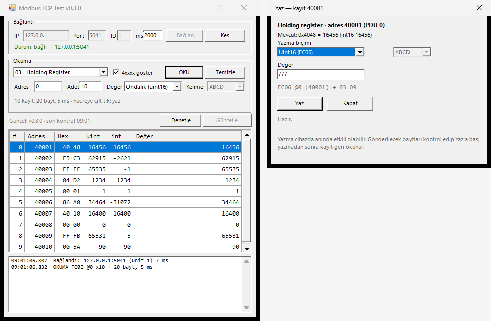

# ModbusScan

Kompakt (500 × 600 px) bir **Modbus TCP test aracı**. `mbpoll`ün okuma tarafını, tek bir `.exe` ve kurulum derdi olmadan sunar.

Okuma: FC01 (coil), FC02 (discrete input), FC03 (holding register), FC04 (input register).
Yazma: FC05 (coil), FC06 (tek register), FC16 (birden çok register) — tabloda bir hücreye çift tıklayarak.
Tarama ve kayıt sekmesi sonraki sürümlerde eklenecek.

## İndir

Releases sayfasındaki `ModbusScan-vX.Y.Z.exe` dosyasını indirip çift tıklaman yeterli:
<https://github.com/dincer552/modbus_scan/releases/latest>

Ek bir şey kurmana gerek yok — Windows 10/11'de gelen .NET Framework 4.8 ile çalışır.

## Kullanım

1. **IP / Port / ID / ms**: cihazın veya gateway'in adresi. Port genelde `502`, zaman aşımı `2000` ms.
2. **Bağlan** → durum satırı yeşile döner.
3. **Fonksiyon** seç, **Adres** (PDU, 0 tabanlı) ve **Adet** (1–125) gir, **OKU**.
4. Tablo her kayıt için ham hex, `uint16`, `int16` ve seçtiğin çözümlenmiş değeri gösterir.
   - **4xxxx göster** işaretliyken adresler mbpoll alışkanlığıyla `40001 / 30001 / 10001 / 00001` biçiminde yazılır; kaldırırsan düz PDU adresi görürsün.
   - **Değer** kutusundan `Float32 / Uint32 / Int32` seçince **Kelime** kutusu açılır: `ABCD` (big-endian), `CDAB` (word swap), `BADC` (byte swap), `DCBA` (little-endian).

## Hücreye çift tıkla → yaz

Okuma tablosundaki bir **Değer** hücresine çift tıklayınca yazma penceresi açılır. Pencere, o satırın gerçek PDU adresini ve okunan ham baytları temel alır; bağlantı kopuksa veya henüz okuma yoksa açılmaz.



- **Uint16 / Int16 / Hex** → FC06 ile tek register yazılır (`0..65535`, `-32768..32767`, `0x1A2B` veya `1A2B`).
- **Float32 / Uint32 / Int32** → FC16 ile iki register yazılır; **Kelime** kutusundan `ABCD / CDAB / BADC / DCBA` sırası seçilir (gönderilen bayt dizilimi, okurken kullandığın sıranın aynısıdır).
- **Coil** satırı → FC05; `ACIK` için `0xFF00`, `KAPALI` için `0x0000` gönderilir.
- **FC02 / FC04** alanları Modbus'ta salt okunurdur: tür kutusu "Salt okunur alan" olur, **Yaz** pasif kalır ve pencere nedeni yazar.

Pencerede gönderilecek baytlar **önizleme** satırında görünür — örn. `FC06 @6 (40007) → 03 09` veya `FC16 @6 x2 (40007) → 40 10 00 00`. Değer aralık dışıysa önizleme kırmızıya döner ve **Yaz** butonu kapanır, yani geçersiz bir istek cihaza gitmez.

**Yaz**'a bastıktan sonra program aynı adresi geri okur ve sonucu gösterir: `Geri okundu: 03 09 = 777 (int16 777)`. Cihaz exception dönerse (örn. `hata kodu 02 – geçersiz adres`) burada yazılıdır. Yazma başarılıysa pencereyi kapattığında tablo otomatik tazelenir ve log'a `YAZMA FC06 @6 başarılı` satırı düşer.

> Yazma cihazda anında etkili olabilir (motor, setpoint, röle). Emin olmadığın bir adrese yazmadan önce okuma yapıp ham baytları karşılaştır.

## Güncelleme denetimi

Pencerenin altındaki şerit programın kendi güncelliğini takip eder:

- Program açıldıktan ~1 saniye sonra bir kez, sonra **her 60 saniyede** GitHub'daki en yeni release etiketi sorgulanır.
- Yeni sürüm varsa satır **yeşile** döner (`YENİ sürüm var: v0.3.0 (32.3 KB)`) ve **Güncelle** butonu aktif olur.
- Sürüm sende ise gri `Güncel: v0.3.0 · son kontrol 08:31` yazarsın; ağ yoksa satır gri kalır ve denemeye devam eder.
- **Denetle** butonu aynı sorguyu elle, hemen yaptırır (log satırında sonucu görünür).
- **Güncelle** exe'yi geçici klasöre indirir, boyutunu ve `MZ` başlığını doğrular, sonra kendini değiştiren kısa bir betik başlatır: program kapanır, betik dosya kilidi çözülünce yenisiyle değiştirip uygulamayı yeniden açar. Değişim olmazsa eski exe açılır ve sürüm sayfası tarayıcıda açılır.
- İndirme sırasında sağ tıklamaya gerek yok; buton **Sayfayı aç** olur ve sürüm sayfasına gider (asset henüz hazır değilse).

Denetim `api.github.com` yerine `https://github.com/dincer552/modbus_scan/releases/latest` yönlendirmesini (302 `Location`) okur; kimliksiz API hız sınırına (saatte 60 istek) takılmamak için dakikada bir kontrol API kullanmaz.

> Exe'nin olduğu klasöre yazma iznin yoksa (ör. `Program Files`) indirme doğrulanır ama değişim başarısız olur; satır nedeni yazar. Bu durumda **Sayfayı aç** ile indirip kendin yerleştirebilirsin.

## Geliştirme

### Derleme

Windows'ta gelen C# derleyicisini kullanır, SDK gerekmez:

```bat
build.bat
```

Çıktı: `dist\ModbusScan.exe` (GUI), `dist\SelfTest.exe` (kendi kendine test) ve `dist\Probe.exe` (konsol okuma aracı).

### Testler

Soket seviyesindeki testler harici sunucu gerektirmez — kendi process'i içinde loopback sunucusu açar:

```bat
dist\SelfTest.exe
```

Bu araç MBAP çerçevelemesini (transaction/unit id, big-endian adres/adet), dört fonksiyon kodunun yanıtını, `uint16/int16/float32/uint32` çözümlerini, kelime sırasını, Modbus exception'ını ve byte count tutarsızlığını doğrular. Yazma tarafında FC05/FC06/FC16 çerçevelerinin doğru baytları taşıdığını, yankı uyuşmazlığını ve her kelime sırası için kodlama ↔ çözme gidiş-dönüşünü kontrol eder. Ayrıca güncelleyicinin saf fonksiyonlarını (etiket çözümleme, 302 hedefinden etiket çıkarma, asset URL'i, sürüm karşılaştırması, boyut biçimleme) ağa çıkmadan test eder.

Gerçek cihaz yokken arayüzü ve tam yığınını denemek için sahte Modbus TCP sunucusu:

```powershell
# 1. terminal
powershell -ExecutionPolicy Bypass -File tools\FakeServer.ps1 -Port 5021

# 2. terminal — konsol probe
dist\Probe.exe --port 5021 --fc 3 --addr 0 --qty 10

# arayüz mantığı (headless, pencere açmadan)
powershell -ExecutionPolicy Bypass -File tools\GuiTest.ps1 -Port 5021
```

`GuiTest.ps1` 37 kontrolü doğrular: dört fonksiyon kodu, `uint16/int16/hex/float32/uint32` çözümleri, `ABCD/CDAB` kelime sırası, `4xxxx` ↔ PDU adres biçimi, adet sınırı, Modbus exception yanıtı, bağlantı kurulamayan durum, yazma penceresi (çift tıkla açılış, adres ve bayt önizleme, FC06/FC16/FC05 yazma + geri okuma, tablonun tazelenmesi, geçersiz değer ve salt okunur alanda pasif **Yaz**), güncelleme şeridi (yeşil "yeni sürüm" + aktif Güncelle, asset yoksa "Sayfayı aç", güncelse pasif buton, denetim hatası, şerit/tablo yerleşimi).

### CI

`v*` tag'i itildiğinde GitHub Actions (windows-latest) derler, `SelfTest.exe`'yi koşar ve exe'yi release asset olarak yayınlar:

```bash
git tag v0.3.0
git push origin v0.3.0
```

Yayınlanan exe'nin adı `ModbusScan-v0.3.0.exe` olur; program tam bu adı `releases/latest` yönlendirmesinden bulduğu etiketle türetir. Etiket adını veya asset adını değiştirirsen güncelleme bozulur.

## Dosyalar

| Yol | Açıklama |
| --- | --- |
| `src/ModbusTcp.cs` | MBAP başlığı + PDU kurulumu, okuma/yazma (FC01–FC06, FC16), veri çözme ve kodlama (hex, uint, int, float, kelime sırası) |
| `src/Updater.cs` | GitHub sürüm denetimi (302 yönlendirmesi), indirme doğrulama, kendini değiştiren betik |
| `src/WriteDialog.cs` | Hücreye çift tıklayınca açılan yazma penceresi (tür seçimi, bayt önizleme, geri okuma) |
| `src/MainForm.cs` | 500 × 600 px pencere, bağlantı ve okuma alanları, sonuç tablosu, log alanı |
| `src/Program.cs` | Giriş noktası ve sürüm bilgisi |
| `tools/SelfTest.cs` | Loopback sunucu ile soket seviyesinde kendi kendine test (CI bunu koşar) |
| `tools/Probe.cs` | Konsol okuma aracı |
| `tools/FakeServer.ps1` | Sahte Modbus TCP sunucusu |
| `tools/GuiTest.ps1` | Arayüz mantığını yansıtma ile test eden betik |

## Bilinen sınırlar

- Sadece Modbus **TCP**; seri (RS485/USB gateway) yok.
- Tek istek = en fazla 125 kayıt; büyük aralıklar için parçala.
- Hata durumunda bağlantı kapanır, **Bağlan** ile yeniden dene.
- Güncelleme denetimi ağa çıkabilmek için TLS 1.2 destekleyen bir Windows sürümü ister; proxy arkasında `github.com` erişimi kapalıysa satır `Denetlenemedi` gösterir ve okuma tarafı bundan etkilenmez.
